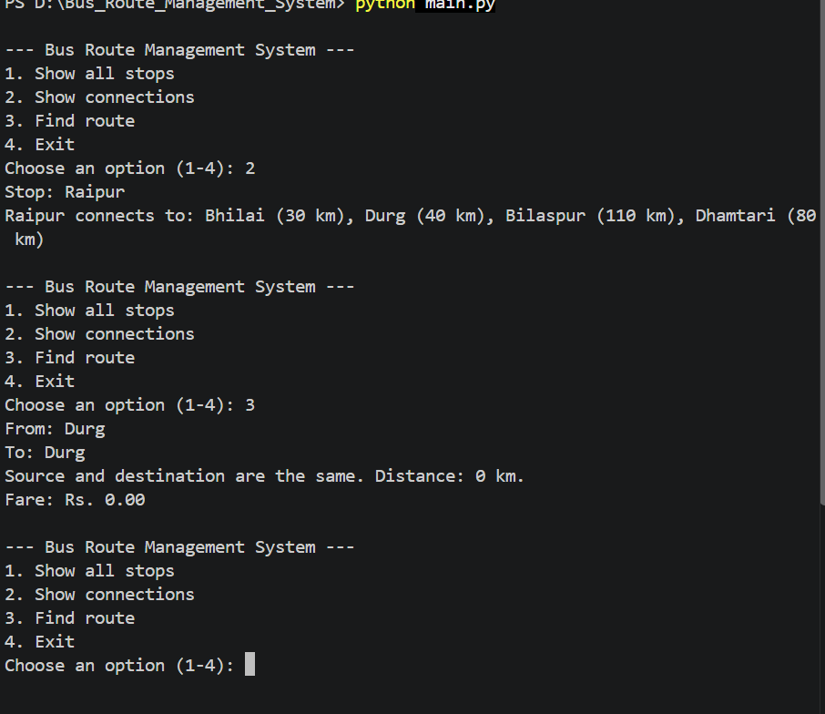
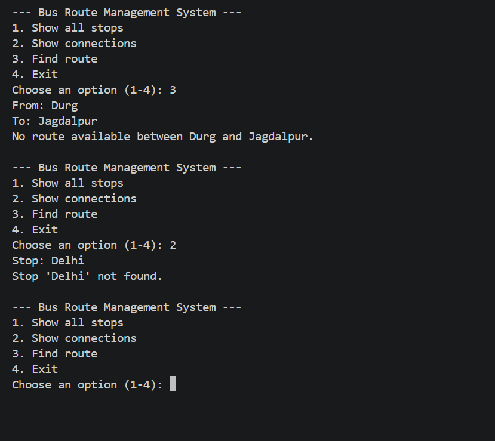
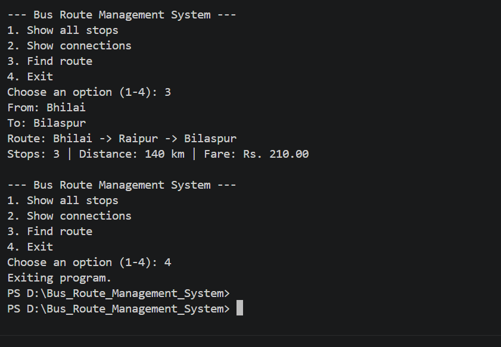

# Bus Route Management System (PS No. 82)

## Project Overview
A console-based Python application that models an intercity bus network as an undirected graph using a dictionary of dictionaries. It allows users to inspect all stops, check direct road connections, and compute the route with the fewest stops between two cities using Breadth-First Search (BFS), along with total distance and fare (Rs. 1.50/km).

- *Student Name:* Abhishek kumar
- *Institution:* Rungta International Skills University (School of Computer Science and Engineering)
- *Program:* B.Tech CSE – First Semester
- *Language:* Python 3

---

## Features & Rules
- *Graph Representation:* Undirected weighted graph stored as a nested dictionary (stop -> {neighbor: distance_km}).
- *Shortest-Hop Routing (BFS):* Uses collections.deque to guarantee the minimum number of stops between source and destination.
- *Fare Calculation:* Automatically computes distance in kilometers and fare at *Rs. 1.50 per km*.
- *Edge Case Handling:* Handles identical source/destination (0 km), disconnected sub-networks (Durg to Jagdalpur), and unknown stop names (Delhi).

---

## Project Structure
- main.py — Core graph data, BFS pathfinding algorithm, and CLI menu.
- README.md — Project overview, instructions, and execution screenshots.
- summary.md — Technical summary and viva preparation notes.
- screenshot/ — Folder containing terminal output screenshots for all test cases.

---

## How to Run
1. Open terminal in the project directory.
2. Run:
```bash
python main.py 
```
## Output Screenshots

### 1. Normal & Boundary Input (Test Case 1 & 2)


### 2. Invalid Input Handling (Test Case 3)


### 3. Different Valid Route Scenario (Test Case 4)
